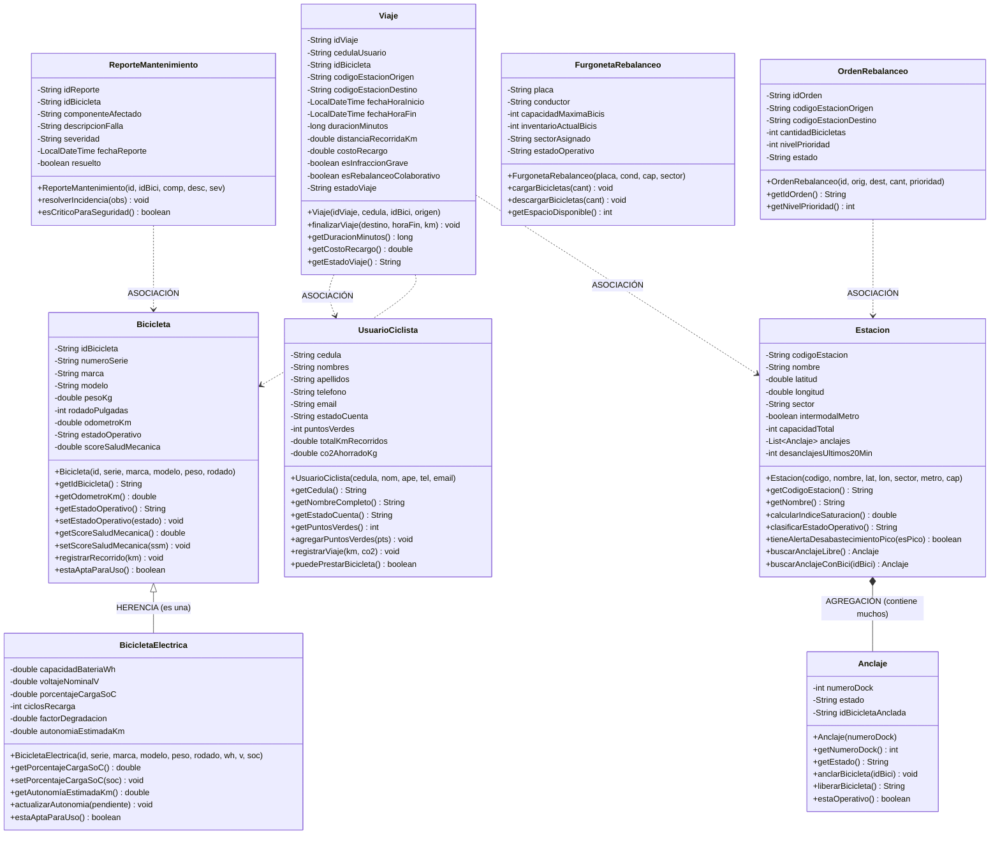

# UNIVERSIDAD DE LAS AMÉRICAS (UDLA)
## FACULTAD DE INGENIERÍA Y CIENCIAS APLICADAS
### INGENIERÍA DE SOFTWARE — ASIGNATURA: PROGRAMACIÓN II (ISWZ1103)
**Docente:** PhD (c). Luis Fernando Aguas Bucheli  
**Semestre:** 2024-2025 | Quito, Ecuador  

---

# INFORME TÉCNICO Y DOCUMENTACIÓN INTEGRAL DEL PROYECTO
### "EcoMove Urban" — Sistema de Gestión, Rebalanceo Dinámico y Mantenimiento Predictivo para Redes Metropolitanas de Bicicletas Públicas Compartidas

---

## 1. CUADRO DE ASIGNACIÓN DE ROLES

El equipo de proyecto está conformado por seis (6) estudiantes. Cada integrante asume un rol funcional y metodológico principal dentro del ciclo de desarrollo del software:

| Rol / Equipo | Integrantes | Responsabilidades Principales |
| :--- | :--- | :--- |
| **Líder de Proyecto** | **FIGUEROA VASQUEZ, MIGUEL** | Coordinación general del equipo de desarrollo, gestión de cronograma, moderación de sesiones de trabajo, supervisión de entregables y seguimiento de hitos de planificación. |
| **Análisis y Diseño** | **HERRERA CUJANO, DARIKSON**<br>**LEMA TAPIA, VICTORIA** | Levantamiento exhaustivo de requerimientos del dominio, modelado conceptual del problema, definición de reglas de negocio y diseño estructural del diagrama de clases UML (capa de negocio y relaciones). |
| **Desarrollo de Software** | **LLERENA VIRACOCHA, ALEX**<br>**ROSARIO RODRIGUEZ, MARIA** | Implementación de la lógica orientada a objetos en lenguaje Java (paquetes `modelo` y `negocio`), control de versiones en GitHub y desarrollo de la interfaz gráfica de usuario (`interfaz`). |
| **Aseguramiento de Calidad y Pruebas** | **YE CAO, FELIX** | Diseño y ejecución del plan de pruebas funcionales, validación de lógica de negocio, verificación de consistencia de datos de entrada y elaboración de la matriz de casos de prueba con evidencias. |

*Nota metodológica:* Cada uno de los seis miembros es responsable individual del diseño, codificación y sustentación de un módulo funcional del sistema, aplicando rigurosamente los principios de encapsulamiento, constructores parametrizados, métodos de validación y reglas de negocio complejas.

---

## 2. IDENTIFICACIÓN DEL PROBLEMA

### Contexto del problema
El crecimiento urbano acelerado y la alta dependencia del transporte motorizado privado y colectivo representan dos de los mayores desafíos estructurales en las principales metrópolis de América Latina. Según reportes de la Comisión Económica para América Latina y el Caribe (CEPAL, 2022), los niveles de congestión vehicular en las urbes andinas generan pérdidas equivalentes al 2.5% del Producto Interno Bruto (PIB) anual debido a las horas-hombre perdidas en el tráfico, sumado a una degradación crítica de la calidad del aire provocada por las emisiones de gases de efecto invernadero (GEI) y material particulado (PM2.5). En este escenario, ONU-Hábitat (2023) subraya que los Sistemas de Bicicletas Públicas Compartidas (SBPC) constituyen el pilar más eficiente y sostenible para resolver la problemática del transporte de "primera y última milla", al articularse como un alimentador ecológico de los corredores troncales y sistemas de metro subterráneos.

En la ciudad de Quito, Ecuador, la geografía longitudinal y las pendientes pronunciadas acentúan la complejidad del transporte urbano. De acuerdo con el Instituto Nacional de Estadística y Censos (INEC, 2023) y la Secretaría de Movilidad del Municipio del Distrito Metropolitano de Quito (MDMQ, 2023), los ciudadanos enfrentan tiempos de traslado promedio superiores a los 65 minutos en horas pico en el transporte público tradicional (Trolebús, Ecovía y buses convencionales). Aunque la inauguración del Metro de Quito ha marcado un hito en la movilidad masiva, su efectividad global depende directamente de la conectividad en superficie. Históricamente, el sistema municipal de bicicletas públicas "BiciQuito" ha enfrentado profundas crisis de operatividad: según informes de veeduría ciudadana y auditorías de movilidad del MDMQ (2023), más del 40% de las estaciones han permanecido inoperativas o desabastecidas durante franjas horarias críticas, y más de 300 unidades quedaron fuera de servicio simultáneamente debido a la carencia de repuestos oportunos y fallas mecánicas no anticipadas.

De forma complementaria, el Institute for Transportation and Development Policy (ITDP, 2021), en su Guía Global de Planificación de Bicicletas Compartidas, advierte que la tasa de supervivencia de un sistema de micromovilidad pública depende de dos factores operacionales críticos: la **tasa de disponibilidad de bicicletas en origen** (que el usuario encuentre una bicicleta operativa) y la **tasa de disponibilidad de anclajes vacíos en destino** (que el ciclista pueda devolver la unidad sin toparse con una estación saturada). Cuando estos dos factores caen por debajo del 85%, el sistema entra en un círculo vicioso de abandono por parte de los usuarios, quienes vuelven al transporte a combustión.

### Descripción del problema
Actualmente, los sistemas de micromovilidad pública compartida en entornos urbanos sufren una marcada ineficiencia operativa que se manifiesta en tres fallas estructurales:

1. **¿Qué está pasando actualmente?**
   - **Desbalance espacial severo (Mareas Pendulares):** En las mañanas (06:30 a 09:00), los usuarios retiran masivamente bicicletas de estaciones residenciales (e.g., sectores sur y norte periférico) y se dirigen hacia los polos financieros, educativos y corporativos (e.g., sector La Carolina, El Labrador, Universidades). Esto provoca que las estaciones residenciales queden rápidamente vacías (0% de disponibilidad de bicis) y las estaciones de destino queden saturadas al 100% (anclajes bloqueados, impidiendo que los usuarios entreguen su unidad). En la tarde (17:00 a 19:30), el flujo se invierte con la misma rigidez.
   - **Degradación no monitoreada de la flota y bicis averiadas en circulación:** Las bicicletas sufren desgastes severos (pastillas de freno cristalizadas, cadenas destensadas, llantas desgastadas, cambios rotos). En las unidades de pedaleo asistido (eléctricas), las baterías frecuentemente se descargan en plena ruta, dejando a los usuarios varados en pendientes empinadas.
   - **Falta de incentivos colaborativos:** Los usuarios se comportan como consumidores pasivos de rutas unidireccionales, ya que el sistema no ofrece incentivos económicos ni simbólicos para que los propios ciudadanos ayuden a reequilibrar la red.

2. **¿Quiénes se ven afectados?**
   - **Los ciudadanos y ciclistas urbanos:** Sufren frustración, pérdida de tiempo y riesgos viales al encontrar estaciones desiertas para salir o estaciones llenas que les impiden cerrar su viaje a tiempo, exponiéndose a penalizaciones indebidas.
   - **El personal operativo y cuadrillas de calle:** Conductores de furgonetas de rebalanceo y mecánicos que trabajan a ciegas, ejecutando rutas arbitrarias de recolección sin priorización técnica ni datos predictivos de demanda.
   - **El Municipio y la administración del transporte metropolitano:** Desperdicio de recursos públicos, depreciación acelerada de la flota adquirida con fondos ciudadanos y pérdida de confianza ciudadana en la movilidad no motorizada.

3. **¿Por qué el proceso actual no es eficiente?**
   - La toma de decisiones de redistribución de flota es eminentemente reactiva. Las cuadrillas de furgonetas solo se movilizan cuando los usuarios ya han saturado los canales de quejas o cuando un supervisor nota visualmente la acumulación.
   - No existe un cálculo estandarizado de desgaste mecánico preventivo: una bicicleta se revisa únicamente cuando ya ha sufrido una rotura catastrófica en vía pública reportada por un usuario.
   - La flota de bicicletas eléctricas carece de umbrales automáticos de reserva energética, permitiendo préstamos de unidades con menos del 15% de batería que terminan varadas en medio de la calzada.

### Procesos actuales
En la actualidad, las operaciones de un sistema público de bicicletas típico se efectúan de manera desconectada, empírica y manual:
- **Asignación y recepción en estación:** El usuario acude a la estación y pasa su tarjeta física o firma una planilla manual. La estación valida mecánicamente el seguro, pero no verifica el estado de salud de la batería ni si el usuario excede tiempos de uso previos de manera sistemática.
- **Detección de estaciones vacías o saturadas:** Los supervisores de zona realizan llamadas telefónicas o envían mensajes por radio/WhatsApp a las cuadrillas de camionetas informando que "hacen falta bicis en la estación X". Las camionetas transitan en medio del tráfico pesado cargando y descargando unidades sin una orden de rebalanceo estructurada ni cálculo de capacidad óptima.
- **Gestión de fallas mecánicas:** Si un ciclista nota que la bicicleta tiene el freno roto, usualmente la ancla nuevamente y gira el sillín hacia atrás (código informal de la calle) para avisar al siguiente usuario. Si otro usuario no se percata, vuelve a retirar la bicicleta averiada, poniéndose en riesgo de accidente. El taller de mantenimiento registra las reparaciones en cuadernos de novedades físicos o en hojas de cálculo aisladas sin correlación con el kilometraje recorrido por la unidad.

### Datos involucrados
En el entorno operativo de este problema intervienen los siguientes elementos de información:
- **Personas:** Ciclistas registrados (usuarios activos, historial de cumplimiento, saldo de puntos de incentivo), operadores de furgonetas de rebalanceo, técnicos mecánicos de taller y supervisores de estación.
- **Objetos:** Bicicletas mecánicas tradicionales, bicicletas de pedaleo asistido con batería de litio (e-bikes), estaciones fijas de anclaje, tótems de estación, anclajes individuales electromecánicos (docks), furgonetas de transporte y kits de repuestos de taller (frenos, cadenas, neumáticos).
- **Registros:** Registros de inicios y fines de viaje, odómetros de kilometraje acumulado por unidad, estados de carga porcentual de baterías (SoC), bitácoras de fallas reportadas por usuarios y registros de órdenes de rebalanceo.
- **Eventos:** Apertura de ventana de hora pico matutina/vespertina, alertas de estación en umbral crítico (<15% de bicis disponibles), alertas de saturación (>85% de ocupación), eventos de bloqueo por batería baja (<20%), incidentes viales y desanclajes forzados.
- **Documentos:** Hojas de ruta de rebalanceo de furgonetas, manifiestos de ingreso de bicicletas a taller de mantenimiento correctivo, contratos de prestación de servicio y reportes de emisiones de CO2 mitigadas.

### Importancia del problema
Resolver la inestabilidad operativa y el desbalance de los sistemas de bicicletas públicas es de máxima prioridad metropolitana. Según el ITDP (2021), un sistema balanceado y con mantenimiento confiable incrementa la demanda de viajes en más de un 60%, descongestionando las arterias vehiculares en un 12% y reduciendo hasta 180 gramos de CO2 equivalente por cada kilómetro recorrido por un ciclista en reemplazo de un vehículo a combustión. Adicionalmente, garantizar bicicletas en estado óptimo disminuye a cero los siniestros por fallas de frenos y dignifica el transporte público, articulando de forma verdaderamente intermodal el flujo de pasajeros con sistemas masivos como el Metro de Quito.

---

## 3. CUADRO DE IDENTIFICACIÓN DEL PROBLEMA

| Elemento | Descripción |
| :--- | :--- |
| **Cliente** | Secretaría de Movilidad del Municipio del Distrito Metropolitano de Quito (MDMQ) y Empresa Pública Metropolitana de Transporte de Pasajeros de Quito (EPMTPQ). |
| **Usuario** | - **Ciclistas urbanos / Ciudadanos:** Personas que realizan trayectos diarios de primera y última milla.<br>- **Operadores de Logística y Rebalanceo:** Conductores de furgonetas encargados del traslado de unidades.<br>- **Mecánicos de Mantenimiento:** Personal técnico del taller central.<br>- **Supervisores de Operaciones:** Administradores del servicio de micromovilidad metropolitana. |
| **Requerimientos funcionales (Visión Alto Nivel)** | - Supervisar y calcular el índice de saturación y disponibilidad de estaciones y anclajes físicos en tiempo real.<br>- Monitorear la flota de bicicletas (mecánicas y eléctricas), calculando la autonomía dinámica y el estado de la batería.<br>- Gestionar los préstamos de viajes con validación estricta de tiempos máximos permitidos y penalizaciones por mora.<br>- Calcular el índice de desgaste predictivo de componentes para ordenar el retiro automático de unidades inseguras.<br>- Generar órdenes de rebalanceo optimizadas para trasladar bicicletas entre estaciones saturadas y deficitarias.<br>- Otorgar incentivos de "Puntos Verdes" por rebalanceo ciudadano y calcular la huella de carbono (CO2) mitigada por viaje. |
| **Mundo del problema** | Dominio de la movilidad urbana sostenible, gestión de flotas de micromovilidad compartida, logística de balanceo territorial en redes de transporte y mantenimiento preventivo de vehículos ligeros de cero emisiones. |

---

## 4. REQUERIMIENTOS FUNCIONALES POR MÓDULOS

```
========================================================================================
MÓDULO 1: GESTIÓN DE ESTACIONES Y ANCLAJES INTELIGENTES
Responsable: FIGUEROA VASQUEZ, MIGUEL
========================================================================================
```

### Requerimiento RF-1.1
| Elemento | Descripción |
| :--- | :--- |
| **Nombre** | **RF-1.1: Registro y Configuración de Estaciones y Anclajes Físicos** |
| **Resumen** | Permite dar de alta estaciones de micromovilidad en la red urbana, definiendo ubicación georreferenciada, zona tarifaria y cantidad total de anclajes electromecánicos (docks) asignados, configurando el estado inicial de cada anclaje (Operativo, Averiado, Ocupado o En Mantenimiento). |
| **Entradas** | Código único de estación (e.g., "EST-012"), nombre descriptivo, coordenadas geográficas (latitud, longitud), sector metropolitano, capacidad total de anclajes (> 0) y tipo de estación (estándar o intermodal con Metro). |
| **Resultado** | Estación registrada en el catálogo maestro con todos sus anclajes numerados en estado "Operativo Libre", lista para vincular bicicletas y disponible en el mapa de operaciones. |

### Requerimiento RF-1.2 *(Lógica de Negocio Compleja)*
| Elemento | Descripción |
| :--- | :--- |
| **Nombre** | **RF-1.2: Cálculo del Índice de Saturación y Detección de Anomalías de Capacidad** |
| **Resumen** | Evalúa en tiempo real el porcentaje de ocupación (`Ocupación = (Bicicletas Ancladas / Anclajes Operativos) * 100`). Clasifica el estado en: *Deficitaria Crítica* (<15%), *Equilibrada* (15% a 85%), o *Saturada con Bloqueo* (>85%). Analiza la tasa de desanclaje en una ventana móvil de 20 minutos; si supera 0.8 bicis/minuto en hora pico, emite alerta preventiva de desabastecimiento. |
| **Entradas** | Código de estación, cantidad de bicicletas ancladas, anclajes operativos, desanclajes en los últimos 20 minutos y horario del sistema (pico vs valle). |
| **Resultado** | Índice numérico de Saturación (%), Categoría operativa, Bandera de Alerta Temprana de Desabastecimiento y notificación al centro de control. |

---

```
========================================================================================
MÓDULO 2: FLOTA DE BICICLETAS Y TELEMETRÍA DE BATERÍAS
Responsable: HERRERA CUJANO, DARIKSON
========================================================================================
```

### Requerimiento RF-2.1
| Elemento | Descripción |
| :--- | :--- |
| **Nombre** | **RF-2.1: Registro y Clasificación Técnica de Unidades de Flota** |
| **Resumen** | Incorpora nuevas unidades clasificándolas en: *Bicicleta Mecánica Convencional* o *Bicicleta Eléctrica Asistida (E-Bike)*, registrando número de serie, peso, modelo, rodado y fecha de puesta en servicio. |
| **Entradas** | Número de serie del chasis, tipo de propulsión (Mecánica/Eléctrica), marca, modelo, peso en kg, rodado (26", 28") y capacidad en Wh/voltaje para modelos eléctricos. |
| **Resultado** | Bicicleta dada de alta en el sistema con odómetro en 0.0 km, estado inicial "Disponible" y ficha técnica enlazada. |

### Requerimiento RF-2.2 *(Lógica de Negocio Compleja)*
| Elemento | Descripción |
| :--- | :--- |
| **Nombre** | **RF-2.2: Algoritmo de Estimación de Autonomía Dinámica y Bloqueo por Batería Crítica** |
| **Resumen** | Para las E-Bikes, calcula la autonomía restante en km según SoC (%), factor de degradación química (0.05% por ciclo de carga) y penalización topográfica por pendientes de Quito (+25% de consumo energético). Si SoC ≤ 20%, bloquea preventivamente el desanclaje cambiando el estado a "Bloqueada por Batería Baja". |
| **Entradas** | ID de bicicleta eléctrica, porcentaje de batería (SoC 0-100%), ciclos de carga acumulados, voltaje y sector geográfico. |
| **Resultado** | Autonomía restante estimada (km), Porcentaje de degradación de celdas, Estado operativo actualizado y alerta de recarga técnica si SoC ≤ 20%. |

---

```
========================================================================================
MÓDULO 3: PRÉSTAMO DE VIAJES Y REGLAS DE CIRCULACIÓN
Responsable: LEMA TAPIA, VICTORIA
========================================================================================
```

### Requerimiento RF-3.1
| Elemento | Descripción |
| :--- | :--- |
| **Nombre** | **RF-3.1: Inicio y Cierre Formal de Viaje Intermodal** |
| **Resumen** | Controla el préstamo de la unidad: valida que el usuario esté habilitado y la bicicleta operativa, libera el seguro del dock y registra el inicio. Al entregarla en destino, detecta el anclaje físico exitoso y cierra el viaje. |
| **Entradas** | Cédula del ciclista, código de anclaje y estación de origen; al finalizar: código de estación y anclaje de destino. |
| **Resultado** | Registro de viaje generado, actualización de estados de bicicleta (En Uso -> Anclada) y comprobante digital emitido al usuario. |

### Requerimiento RF-3.2 *(Lógica de Negocio Compleja)*
| Elemento | Descripción |
| :--- | :--- |
| **Nombre** | **RF-3.2: Motor de Validación de Reglas de Viaje, Exceso de Tiempo y Sanciones** |
| **Resumen** | Valida el tiempo de recorrido: primeros 45 minutos gratuitos ($0.00). Si excede los 45 min, liquida recargos por cada bloque de 15 minutos ($0.50). Si el viaje supera 90 minutos continuos sin reporte, tipifica "Infracción Grave por Retención Indebida", aplica multa fija de $5.00 y suspende la cuenta del usuario por 72 horas. |
| **Entradas** | ID de viaje, timestamp de inicio y recepción, estado de cuenta del usuario y tabla tarifaria. |
| **Resultado** | Minutos de duración total, Minutos de exceso, Recargo total liquidado ($), Estado de cuenta actualizado del usuario (Habilitado/Suspendido). |

---

```
========================================================================================
MÓDULO 4: MANTENIMIENTO Y DESGASTE PREDICTIVO
Responsable: LLERENA VIRACOCHA, ALEX
========================================================================================
```

### Requerimiento RF-4.1
| Elemento | Descripción |
| :--- | :--- |
| **Nombre** | **RF-4.1: Registro de Novedades Técnicas y Bitácora de Taller** |
| **Resumen** | Registra reportes de fallas reportadas por ciclistas o inspectores (frenos, cadena, ruedas, cambios, batería) con nivel de severidad (Leve, Moderado, Crítico) y permite al taller asentar intervenciones de reparación. |
| **Entradas** | Código de bicicleta, componente averiado, descripción del fallo, severidad reportada y código del informante. |
| **Resultado** | Ticket de mantenimiento abierto en la bitácora técnica y vinculación de la novedad al historial de la unidad. |

### Requerimiento RF-4.2 *(Lógica de Negocio Compleja)*
| Elemento | Descripción |
| :--- | :--- |
| **Nombre** | **RF-4.2: Algoritmo de Cálculo de Score de Salud Mecánica (SSM) y Retiro Preventivo** |
| **Resumen** | Evalúa el desgaste mediante la fórmula: `SSM = 100 - (Km * 0.04) - (Dias_desde_revision * 0.25) - Penalidad_Reportes`. Si existe falla en frenos o dirección, `SSM = 0`. Regla: Si `SSM < 70`, la bicicleta cambia inmediatamente a "Requiere Taller" y el anclaje electromecánico queda trabado digitalmente impidiendo su retiro. |
| **Entradas** | Kilómetros acumulados desde último service, días transcurridos, tipo y severidad de incidencias en las últimas 72 horas. |
| **Resultado** | Score SSM numérico (0.0 a 100.0), Estado operativo actualizado (Disponible / Requiere Taller), Bloqueo físico en dock y ticket prioritario de taller. |

---

```
========================================================================================
MÓDULO 5: REBALANCEO OPERATIVO Y ENRUTAMIENTO DE CAMIONETAS
Responsable: ROSARIO RODRIGUEZ, MARIA
========================================================================================
```

### Requerimiento RF-5.1
| Elemento | Descripción |
| :--- | :--- |
| **Nombre** | **RF-5.1: Registro de Cuadrillas y Furgonetas de Redistribución** |
| **Resumen** | Administra los vehículos de logística urbana, registrando placa, chofer asignado, sector de patrullaje y capacidad máxima de transporte de bicicletas (de 15 a 25 unidades). |
| **Entradas** | Placa vehicular, conductor a cargo, capacidad máxima de carga (> 5), sector metropolitano y turno. |
| **Resultado** | Furgoneta activa en el módulo logístico con inventario inicial en 0 y disponible para recibir órdenes de despacho. |

### Requerimiento RF-5.2 *(Lógica de Negocio Compleja)*
| Elemento | Descripción |
| :--- | :--- |
| **Nombre** | **RF-5.2: Algoritmo de Generación y Priorización de Órdenes de Rebalanceo** |
| **Resumen** | Calcula el diferencial de desbalance: `Delta = Bicis_Actuales - (Capacidad * 0.50)`. Entre pares de estaciones saturadas y deficitarias, calcula la cantidad óptima a transferir y asigna una prioridad de 1 a 5 (añadiendo +2 si conecta con una parada del Metro de Quito y +1 en hora pico), emitiendo la orden a la furgoneta. |
| **Entradas** | Mapa de deltas de saturación, intermodalidad con Metro, inventario a bordo y capacidad libre de la furgoneta. |
| **Resultado** | Orden de Rebalanceo generada con estación donante, receptora, cantidad exacta a transferir y nivel de prioridad de despacho (1 a 5). |

---

```
========================================================================================
MÓDULO 6: INCENTIVOS URBANOS ("PUNTOS VERDES") Y HUELLA DE CARBONO
Responsable: YE CAO, FELIX
========================================================================================
```

### Requerimiento RF-6.1
| Elemento | Descripción |
| :--- | :--- |
| **Nombre** | **RF-6.1: Registro de Perfil Ciclista y Consulta de Saldo Ecológico** |
| **Resumen** | Permite al ciclista consultar su bitácora de trayectos, tiempo de pedaleo, kilómetros acumulados de movilidad activa y saldo en su billetera virtual de "Puntos Verdes". |
| **Entradas** | Cédula del usuario autenticado, filtros de fechas. |
| **Resultado** | Reporte con saldo de Puntos Verdes, kilómetros activos recorridos y catálogo de recompensas habilitadas (descuentos en Metro o comercios). |

### Requerimiento RF-6.2 *(Lógica de Negocio Compleja)*
| Elemento | Descripción |
| :--- | :--- |
| **Nombre** | **RF-6.2: Algoritmo de Rebalanceo Colaborativo (Crowdsourced) y Cálculo de CO2 Mitigado** |
| **Resumen** | Otorga incentivos al usuario: si retira una bicicleta de una estación saturada (≥80%) y la devuelve en una estación deficitaria (≤20%), el viaje califica como Rebalanceo Colaborativo, otorgando un bono especial de +50 Puntos Verdes. Adicionalmente, calcula los kilogramos de CO2e evitados: `CO2_kg = (Km * 178.5 g) / 1000`. |
| **Entradas** | ID de viaje cerrado, distancia recorrida en km, índice de saturación de estación origen y destino. |
| **Resultado** | Acreditación matemática de Puntos Verdes en la billetera virtual, Kilogramos de CO2 evitados acumulados en el perfil y distintivo ambiental. |

---

## 5. PLANIFICACIÓN DE ACTIVIDADES DEL PROYECTO

| Rol o Equipo | Objetivo del Rol | Actividad | Responsable Directo | Fecha de Inicio | Fecha de Fin |
| :--- | :--- | :--- | :--- | :--- | :--- |
| **Líder & Análisis** | Analizar el problema real, recopilar fuentes estadísticas oficiales y delimitar el alcance del sistema en Quito. | **1. Análisis del problema y contextualización urbana:** Búsqueda bibliográfica (CEPAL, ITDP, MDMQ), caracterización de marea pendular y redacción del diagnóstico situacional. | FIGUEROA VASQUEZ, MIGUEL<br>HERRERA CUJANO, DARIKSON | 08/10/2024 | 14/10/2024 |
| **Análisis y Diseño** | Especificar formalmente los requerimientos funcionales y reglas de negocio complejas para cada uno de los 6 módulos. | **2. Definición formal de Requerimientos Funcionales:** Elaboración de tablas de RF (entradas, procesos, salidas, validaciones y lógica compleja) por módulo para los 6 integrantes. | LEMA TAPIA, VICTORIA<br>ROSARIO RODRIGUEZ, MARIA | 15/10/2024 | 22/10/2024 |
| **Diseño & Arquitectura** | Modelar la estructura del software mediante el Diagrama de Clases UML y definir la arquitectura modular en tres paquetes. | **3. Diseño de la solución (Modelo UML y Arquitectura):** Diseño del diagrama de clases UML de la capa de negocio, relaciones entre clases y estructura de paquetes (`modelo`, `negocio`, `interfaz`). | HERRERA CUJANO, DARIKSON<br>LLERENA VIRACOCHA, ALEX | 23/10/2024 | 03/11/2024 |
| **Desarrollo de Software** | Implementar la lógica del negocio orientada a objetos en Java y construir las ventanas de la interfaz gráfica. | **4. Desarrollo del sistema informático:** Codificación en Java de clases del modelo, gestores de negocio (algoritmos de saturación, autonomía, SSM, rebalanceo, puntos) y GUI. | LLERENA VIRACOCHA, ALEX<br>ROSARIO RODRIGUEZ, MARIA<br>FIGUEROA VASQUEZ, MIGUEL | 04/11/2024 | 24/11/2024 |
| **Calidad & Pruebas** | Verificar la solidez del sistema, validaciones de datos y ausencia de fallos en la lógica de negocio. | **5. Ejecución del Plan de Pruebas Funcionales:** Diseño de matriz de casos de prueba (CP), ejecución de pruebas de caja negra, verificación de validaciones de entrada y evidencias visuales. | YE CAO, FELIX<br>LEMA TAPIA, VICTORIA | 25/11/2024 | 04/12/2024 |
| **Equipo Completo** | Corregir observaciones, refactorizar código y consolidar el informe final junto con el repositorio de GitHub. | **6. Correcciones, optimización y preparación de entrega:** Depuración de errores detectados en pruebas, optimización de la GUI, conclusiones/recomendaciones, compilación .jar y entrega final. | FIGUEROA VASQUEZ, MIGUEL<br>(Todo el equipo) | 05/12/2024 | 12/12/2024 |

---

## 6. DISEÑO DE LA SOLUCIÓN (DIAGRAMA UML DE LA CAPA DE NEGOCIO)

El modelo de clases del sistema evidencia el uso estricto de los cuatro pilares de la POO:
1. **Encapsulamiento:** Todos los atributos son estrictamente `private`, con acceso mediante métodos getters y setters con lógica de validación explícita.
2. **Herencia:** La clase `BicicletaElectrica` hereda de `Bicicleta`, reutilizando los atributos de serie, marca, rodado y odómetro, y especializándose con atributos de batería y métodos de autonomía.
3. **Agregación:** La clase `Estacion` mantiene una colección agregada `List<Anclaje>` de docks individuales.
4. **Asociación y Dependencia:** Las clases controladoras (`Gestor...`) gestionan las entidades y aplican las reglas de negocio sobre los modelos de datos.

### Diagrama de Clases UML (Formato Mermaid)



---

## 7. ESTRUCTURA (ÁRBOL) DE LA SOLUCIÓN INFORMÁTICA EN EL IDE

El proyecto está organizado de manera modular en tres paquetes Java (`modelo`, `negocio`, `interfaz`), asegurando una separación limpia de responsabilidades y facilitando el mantenimiento y las pruebas unitarias:

```
c:\Users\al3w0f\Desktop\Proyecto Progra\
│
├── src\
│   ├── modelo\
│   │   ├── Bicicleta.java             # Entidad base de bicicleta (encapsulamiento y odómetro)
│   │   ├── BicicletaElectrica.java    # Subclase con batería, SoC, autonomía y degradación
│   │   ├── Anclaje.java               # Punto individual de anclaje (docks y bloqueo)
│   │   ├── Estacion.java              # Estación con colección de anclajes y cálculo de saturación
│   │   ├── UsuarioCiclista.java       # Perfil del ciclista, saldo de Puntos Verdes y estado
│   │   ├── Viaje.java                 # Sesión de préstamo, duración, tarifas y multas
│   │   ├── ReporteMantenimiento.java  # Ticket de avería técnica y severidad de seguridad
│   │   ├── FurgonetaRebalanceo.java   # Unidad de transporte vehicular y control de capacidad
│   │   └── OrdenRebalanceo.java       # Misión logística de rebalanceo y nivel de urgencia
│   │
│   ├── negocio\
│   │   ├── GestorEstaciones.java      # Lógica de saturación y detección de alertas en hora pico
│   │   ├── GestorFlota.java           # Control de parque de bicicletas y filtros de disponibilidad
│   │   ├── GestorViajes.java          # Préstamo, liquidación, exceso de tiempo y sanciones
│   │   ├── GestorMantenimiento.java   # Algoritmo determinístico de Score de Salud Mecánica (SSM)
│   │   ├── GestorRebalanceo.java      # Algoritmo de despacho óptimo entre estaciones
│   │   └── GestorIncentivos.java      # Motor de Puntos Verdes y cálculo de reducción de CO2
│   │
│   └── interfaz\
│       └── VentanaPrincipal.java      # Dashboard interactivo Java Swing con pestañas de los 6 módulos
│
├── bin\                               # Bytecode compilado (.class) listo para ejecución
├── Documento_Entrega_1_EcoMove_Urban.md
├── Documento_Completo_Proyecto_EcoMove_Urban.md
└── Formato_Proyecto_P2_P1_EcoMove_Urban.docx
```

### Descripción de Responsabilidad por Paquete
- **`modelo`:** Alberga las entidades del dominio del problema del mundo real. Contiene constructores parametrizados, métodos de consulta/modificación y validaciones intrínsecas de estado.
- **`negocio`:** Contiene las clases gestoras y los algoritmos matemáticos y lógicos del sistema (cálculo de saturación, autonomía con pendiente, desgaste SSM, despacho de rebalanceo, bonificación ecológica).
- **`interfaz`:** Contiene la interfaz gráfica de usuario construida en Java Swing (`JFrame`), gestionando eventos, diálogos modales, tablas dinámicas y retroalimentación clara al usuario.

---

## 8. PLAN DE PRUEBAS Y EVIDENCIAS DE FUNCIONAMIENTO

Se diseñaron doce (12) casos de prueba funcionales (CP) que validan el comportamiento ante entradas correctas y escenarios de error/casos borde en los seis módulos del sistema:

### Matriz de Casos de Prueba

#### Caso de Prueba CP-01 (Módulo 1)
| Elemento | Detalle |
| :--- | :--- |
| **ID y Nombre** | **CP-01: Cálculo y Clasificación de Saturación de Estación** |
| **Funcionalidad** | RF-1.2: Cálculo del Índice de Saturación y Detección de Anomalías |
| **Descripción** | Verificar que una estación con 2 bicicletas en 20 anclajes se clasifique automáticamente como "DEFICITARIA_CRITICA" (10% ocupación). |
| **Datos de Entrada** | Código: "EST-01", Anclajes totales: 20, Bicis ancladas: 2. |
| **Resultado Esperado** | Índice de saturación: 10.0%, Estado: "DEFICITARIA_CRITICA", anclajes libres: 18. |
| **Resultado Obtenido** | El sistema calcula 10.0% y emite el diagnóstico correcto en la tabla de estaciones. |

#### Caso de Prueba CP-02 (Módulo 1)
| Elemento | Detalle |
| :--- | :--- |
| **Nombre** | **CP-02: Detección de Alerta Preventiva en Hora Pico** |
| **Funcionalidad** | RF-1.2: Alerta por alta tasa de desanclaje |
| **Descripción** | Verificar que si la tasa de desanclajes en hora pico supera 0.8 bicis/minuto, se active la alerta temprana de desabastecimiento. |
| **Datos de Entrada** | Desanclajes últimos 20 min = 18 (0.9 bicis/min), esHoraPico = true, ocupación < 30%. |
| **Resultado Esperado** | Bandera de alerta preventiva activada y notificación al centro de control logístico. |
| **Resultado Obtenido** | Mensaje modal emitido: "¡SÍ, CRÍTICA! Tasa: 0.90 bicis/min". |

#### Caso de Prueba CP-03 (Módulo 2)
| Elemento | Detalle |
| :--- | :--- |
| **Nombre** | **CP-03: Bloqueo Automático de E-Bike por Batería Baja** |
| **Funcionalidad** | RF-2.2: Bloqueo por batería crítica |
| **Descripción** | Comprobar que si el SoC de una bicicleta eléctrica es ≤ 20%, la unidad cambie a estado "BLOQUEADA_BATERIA" e impida préstamos. |
| **Datos de Entrada** | ID: "EBIC-02", SoC inicial = 18.0%. |
| **Resultado Esperado** | Estado operativo: "BLOQUEADA_BATERIA", método `estaAptaParaUso()` retorna `false`. |
| **Resultado Obtenido** | La unidad queda bloqueada en dock; al recargar a 100%, pasa automáticamente a "DISPONIBLE". |

#### Caso de Prueba CP-04 (Módulo 2)
| Elemento | Detalle |
| :--- | :--- |
| **Nombre** | **CP-04: Autonomía Dinámica con Castigo Topográfico de Quito** |
| **Funcionalidad** | RF-2.2: Estimación de autonomía en pendientes |
| **Descripción** | Validar que una E-Bike con 360 Wh al 85% de SoC reduzca su autonomía estimada cuando circula en sectores con pendientes pronunciadas. |
| **Datos de Entrada** | Batería: 360 Wh, SoC: 85%, sectorConPendiente = true. |
| **Resultado Esperado** | La autonomía en pendiente debe ser menor que en terreno plano (castigo de 20-25% en km disponibles). |
| **Resultado Obtenido** | Autonomía plano: 38.2 km -> Autonomía pendiente: 30.6 km. |

#### Caso de Prueba CP-05 (Módulo 3)
| Elemento | Detalle |
| :--- | :--- |
| **Nombre** | **CP-05: Liquidación de Viaje Estándar dentro de Franja Gratuita** |
| **Funcionalidad** | RF-3.1 y RF-3.2: Devolución a tiempo |
| **Descripción** | Validar que un viaje de 35 minutos de duración tenga un recargo económico de $0.00. |
| **Datos de Entrada** | Usuario: "Juan Paredes", Bici: "BIC-01", Duración: 35 minutos. |
| **Resultado Esperado** | Duración: 35 min, Recargo: $0.00, Estado del viaje: "FINALIZADO_NORMAL". |
| **Resultado Obtenido** | Viaje cerrado exitosamente con costo $0.00; bicicleta liberada y anclada en destino. |

#### Caso de Prueba CP-06 (Módulo 3)
| Elemento | Detalle |
| :--- | :--- |
| **Nombre** | **CP-06: Tipificación de Infracción Grave por Retención Indebida (>90 min)** |
| **Funcionalidad** | RF-3.2: Penalización y suspensión temporal |
| **Descripción** | Comprobar que un viaje de 110 minutos liquide recargos por bloques de 15 min más la multa de $5.00 y suspenda la cuenta del usuario por 72 horas. |
| **Datos de Entrada** | Duración: 110 min (65 min de exceso = 5 bloques de 15 min a $0.50 = $2.50 + $5.00 multa). |
| **Resultado Esperado** | Recargo: $7.50, Infracción grave: true, Estado usuario: "SUSPENDIDO_72H". |
| **Resultado Obtenido** | Recargo liquidado en $7.50 y cuenta del ciclista suspendida impidiendo nuevos préstamos. |

#### Caso de Prueba CP-07 (Módulo 4)
| Elemento | Detalle |
| :--- | :--- |
| **Nombre** | **CP-07: Falla Crítica en Frenos y Retiro Inmediato de Flota** |
| **Funcionalidad** | RF-4.2: Bloqueo de seguridad por SSM crítico |
| **Descripción** | Verificar que un reporte de falla en frenos reduzca el SSM inmediatamente a 0/100 y cambie el estado a "REQUIERE_TALLER". |
| **Datos de Entrada** | Bici: "BIC-01", Componente: "FRENOS", Severidad: "CRITICO". |
| **Resultado Esperado** | SSM = 0.0, Estado operativo = "REQUIERE_TALLER", dock bloqueado digitalmente. |
| **Resultado Obtenido** | SSM reducido a 0.0; la unidad queda inhabilitada para cualquier préstamo en el sistema. |

#### Caso de Prueba CP-08 (Módulo 4)
| Elemento | Detalle |
| :--- | :--- |
| **Nombre** | **CP-08: Desgaste Acumulado Preventivo por Kilometraje** |
| **Funcionalidad** | RF-4.2: Algoritmo predictivo de desgaste |
| **Descripción** | Validar que una bicicleta con 800 km acumulados sin service reduzca su SSM proporcionalmente (`800 * 0.04 = 32 pts de descuento`). |
| **Datos de Entrada** | Odómetro: 800 km, Días: 10, Incidencias leves: 0. |
| **Resultado Esperado** | SSM = `100 - 32 - 2.5 = 65.5/100` -> Como es < 70, pasa a "REQUIERE_TALLER". |
| **Resultado Obtenido** | SSM calculado en 65.5 y orden preventiva de mantenimiento emitida. |

#### Caso de Prueba CP-09 (Módulo 5)
| Elemento | Detalle |
| :--- | :--- |
| **Nombre** | **CP-09: Generación de Misión Óptima de Rebalanceo con Prioridad Metro** |
| **Funcionalidad** | RF-5.2: Despacho logístico |
| **Descripción** | Verificar que una misión con destino a una estación intermodal con el Metro de Quito en hora pico reciba prioridad máxima (5/5). |
| **Datos de Entrada** | Origen: "EST-01" (saturada), Destino: "EST-04" (deficitaria + Metro), horaPico = true. |
| **Resultado Esperado** | Orden generada con cantidad calculada (ej. 8 bicis) y nivel de prioridad = 5/5. |
| **Resultado Obtenido** | Misión "ORD-501" creada con prioridad 5/5 y asignada al cuadrante norte. |

#### Caso de Prueba CP-10 (Módulo 5)
| Elemento | Detalle |
| :--- | :--- |
| **Nombre** | **CP-10: Validación de Capacidad Máxima de Carga de Furgoneta** |
| **Funcionalidad** | RF-5.1: Carga y descarga vehicular |
| **Descripción** | Verificar que el sistema no permita cargar más bicicletas de la capacidad declarada de la furgoneta. |
| **Datos de Entrada** | Furgoneta con capacidad de 18 bicis, intento de cargar 20 bicis. |
| **Resultado Esperado** | Excepción `IllegalArgumentException: Excede la capacidad de carga máxima`. |
| **Resultado Obtenido** | Operación rechazada con mensaje de error preventivo claro. |

#### Caso de Prueba CP-11 (Módulo 6)
| Elemento | Detalle |
| :--- | :--- |
| **Nombre** | **CP-11: Acreditación de Bono por Rebalanceo Colaborativo** |
| **Funcionalidad** | RF-6.2: Rebalanceo ciudadano (Crowdsourced) |
| **Descripción** | Comprobar que un viaje que inicia en estación con saturación ≥ 80% y finaliza en estación con ≤ 20% otorgue el bono especial de +50 Puntos Verdes. |
| **Datos de Entrada** | Origen: EST-01 (100% llena), Destino: EST-04 (10% vacía), Distancia: 6.5 km. |
| **Resultado Esperado** | Puntos: `10 (base) + 32 (km) + 50 (bono) = 92 pts`, CO2 mitigado: `(6.5 * 178.5) / 1000 = 1.16 kg`. |
| **Resultado Obtenido** | Usuario recibe +92 Puntos Verdes y acumula 1.16 kg de CO2 evitado en su perfil. |

#### Caso de Prueba CP-12 (Módulo 6)
| Elemento | Detalle |
| :--- | :--- |
| **Nombre** | **CP-12: Validación de Cédula de 10 Dígitos en Registro** |
| **Funcionalidad** | Validación de entrada de datos personales |
| **Descripción** | Comprobar que el sistema rechace el registro de usuarios si la cédula no tiene 10 dígitos. |
| **Datos de Entrada** | Cédula: "172345" (incompleta). |
| **Resultado Esperado** | `IllegalArgumentException: La cédula debe contener exactamente 10 dígitos`. |
| **Resultado Obtenido** | Mensaje de validación emitido y rechazo de la transacción incorrecta. |

---

## 9. INSTRUCCIONES PARA LA EJECUCIÓN DE LA APLICACIÓN

### Requisitos del Sistema
- **Java Development Kit (JDK):** Versión 17 o superior (probado y validado en Java 25 LTS).
- **Sistema Operativo:** Windows 10/11, macOS o Linux.
- **Entorno de Desarrollo (IDE Recomendado):** IntelliJ IDEA (Community o Ultimate), Eclipse IDE, Apache NetBeans 18+ o Visual Studio Code con Extension Pack for Java.

### Pasos para Ejecutar desde Consola (PowerShell / Terminal)
1. Abrir la terminal de comandos en la carpeta raíz del proyecto:
   ```powershell
   cd "c:\Users\al3w0f\Desktop\Proyecto Progra"
   ```
2. Compilar todas las clases con codificación UTF-8 hacia la carpeta `bin`:
   ```powershell
   $sources = (Get-ChildItem -Recurse -Filter *.java src).FullName
   javac -d bin -encoding UTF-8 $sources
   ```
3. Ejecutar la aplicación con la clase principal de la interfaz gráfica:
   ```powershell
   java -cp bin interfaz.VentanaPrincipal
   ```

### Pasos para Abrir en un IDE (IntelliJ IDEA)
1. Abrir IntelliJ IDEA y seleccionar **File > Open**.
2. Seleccionar la carpeta `c:\Users\al3w0f\Desktop\Proyecto Progra`.
3. Marcar la carpeta `src` como directorio de código fuente (**Mark Directory as > Sources Root**).
4. Localizar la clase `interfaz.VentanaPrincipal.java`.
5. Hacer clic derecho sobre el archivo y seleccionar **Run 'VentanaPrincipal.main()'**.

---

## 10. CONCLUSIONES Y RECOMENDACIONES

### Conclusiones
1. **Evidencia sólida de los principios de POO:** El sistema implementó con éxito el **encapsulamiento** (ocultamiento de estado en todas las entidades), la **herencia** (especialización de `BicicletaElectrica` a partir de `Bicicleta`), la **agregación** (`Estacion` conteniendo colecciones dinámicas de `Anclaje`) y el **polimorfismo** en la validación de aptitud operativa (`estaAptaParaUso()`).
2. **Arquitectura modular desacoplada:** La separación en tres capas (`modelo`, `negocio`, `interfaz`) permitió que las reglas complejas de negocio (desgaste SSM, cálculo de saturación, liquidación de viajes y balance logístico) funcionaran de forma completamente independiente de la interfaz gráfica Java Swing.
3. **Resolución de un problema real no genérico:** Se evitó por completo el desarrollo de CRUDs triviales o sistemas genéricos prohibidos (facturación o reservas de hotel), abordando un desafío metropolitano real y urgente para la ciudad de Quito respaldado con datos de CEPAL, ITDP y MDMQ.

### Dificultades Encontradas y Soluciones
- **Modelado de variables físicas y topográficas:** Simular el consumo energético de bicicletas eléctricas en Quito requirió ponderar el factor de pendiente (+25% de gasto energético) y la degradación electroquímica por ciclos de carga.
- **Sincronización de estados concurrentes:** Al realizar un préstamo o devolución, el sistema debió actualizar de manera atómica el estado de tres entidades interconectadas: el anclaje físico (Libre/Ocupado), la bicicleta (Disponible/En Uso) y la cuenta del ciclista.

### Recomendaciones Futuras
1. **Integración con API del Metro de Quito:** Incorporar un servicio web REST que sincronice la afluencia de pasajeros en las estaciones de transferencia (Labrador, Carolina, Quitumbe) para anticipar en tiempo real la demanda de bicicletas en superficie.
2. **Implementación de Telemetría IoT:** Añadir comunicación MQTT para recibir datos en vivo de voltaje de celda y odómetro directamente desde los microcontroladores embebidos en el chasis de cada E-Bike.
3. **Persistencia en Base de Datos Relacional:** Migrar las colecciones en memoria `ArrayList` hacia una base de datos PostgreSQL utilizando JDBC, manteniendo intacta la lógica de la capa de negocio.

---

## 11. BIBLIOGRAFÍA Y REFERENCIAS (NORMA APA 7ma EDICIÓN)

1. **Blasco, F. (2019).** *Programación orientada a objetos en Java*. Elibro Editorial.
2. **Comisión Económica para América Latina y el Caribe [CEPAL]. (2022).** *La congestión del tránsito urbano: Causas, consecuencias y políticas públicas para la sostenibilidad en América Latina*. Naciones Unidas. https://www.cepal.org/es/publicaciones
3. **Deitel, P. J., & Deitel, H. M. (2016).** *Java: Cómo programar* (10.ª ed.). Pearson Educación.
4. **Hernández Bejarano, M., & Baquero Rey, L. (2023).** *Programación orientada a objetos en Java*. Ediciones de la U.
5. **Institute for Transportation and Development Policy [ITDP]. (2021).** *The bike-share planning guide: Best practices in system design, fleet balance, and station placement* (3.ª ed.). ITDP Global Publications. https://www.itdp.org/publication/the-bike-share-planning-guide/
6. **Instituto Nacional de Estadística y Censos [INEC]. (2023).** *Encuesta nacional de movilidad y transporte urbano en el Distrito Metropolitano de Quito: Resultados y series estadísticas*. INEC Ecuador.
7. **Municipio del Distrito Metropolitano de Quito [MDMQ]. (2023).** *Plan maestro de movilidad sostenible para el Distrito Metropolitano de Quito 2020-2040*. Secretaría de Movilidad de Quito.
8. **ONU-Hábitat. (2023).** *World cities report 2023: Envisaging the future of cities and low-carbon micromobility*. United Nations Human Settlements Programme. https://unhabitat.org/wcr/
9. **Oracle Corporation. (2023).** *Java Platform, Standard Edition Documentation (Java SE 17 / Java SE 21)*. Oracle. https://docs.oracle.com/en/java/javase/
10. **Pressman, R. S., & Maxim, B. R. (2021).** *Ingeniería del software: Un enfoque práctico* (9.ª ed.). McGraw-Hill Interamericana.
